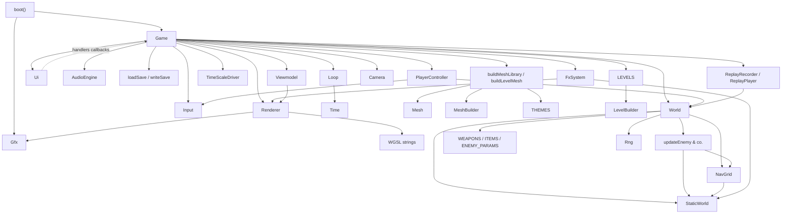
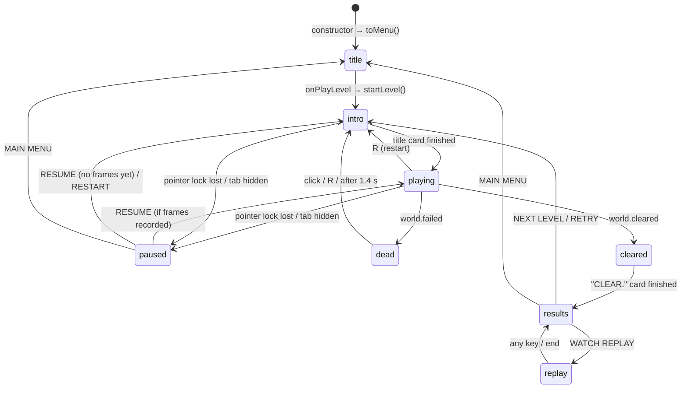
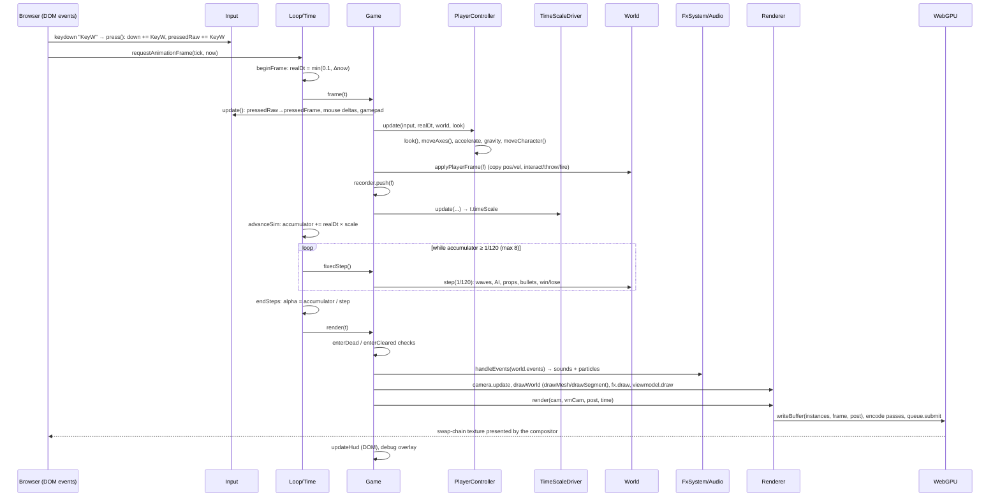

# PART 1 — Understanding *STILLFRAME*

> Subject: [`Lab05-Testing-Index.html`](legacy/Lab05-Testing-Index.html) — a single-file (≈7 400 lines, ≈238 KB) WebGPU game generated with AI.
> Scope of this document: what the game is, how it is built, how a frame flows through the code, and design problems worth fixing.
> Bugs (e.g. the PLAY button not starting the game) are deliberately **not** investigated here.

---

## 1. The game at a glance

| | |
|---|---|
| **Title** | STILLFRAME — tagline *"time moves only when you move"* ([L3541-L3542](legacy/Lab05-Testing-Index.html#L3541-L3542)) |
| **Genre** | First-person shooter / action-puzzle, a clear homage to *SUPERHOT* |
| **Tech** | Plain HTML + one ES module, **WebGPU** renderer with hand-written WGSL shaders, Web Audio with procedurally synthesised sounds, `localStorage` saves. Only external dependency: `wgpu-matrix` from a CDN ([L505](legacy/Lab05-Testing-Index.html#L505)). |
| **Content** | 15 hand-built levels in 3 acts: **TRANSIT** (Platform, Carriage, Turnstiles, Escalator, Last Train), **OFFICE TOWER** (Lobby, Elevator, Cubicles, Server Room, Boardroom), **ROOFTOPS** (Ledge, Skylight, Crossing, Helipad, Spire) ([L2611-L3392](legacy/Lab05-Testing-Index.html#L2611-L3392)) |
| **Visual style** | Flat white/grey low-poly world, glowing glass-like crystalline enemies that shatter on death, outlines, bloom, desaturation when time is frozen. |

### 1.1 Goal of the player
- **Default win condition:** kill every enemy of every wave in the level (`checkWin`, [L5775-L5792](legacy/Lab05-Testing-Index.html#L5775-L5792)). Waves are triggered by `start`, `remaining` (enemies left ≤ N), `zone` (player enters a rectangle) or `time` conditions ([L5720-L5758](legacy/Lab05-Testing-Index.html#L5720-L5758)).
- **Exit levels** (e.g. *Server Room*, *Crossing*): reach an exit rectangle, optionally only after all enemies are dead (`exit.requiresClear`).
- **One-hit death on both sides:** a single bullet or melee hit kills the player; any bullet or a thrown object to the head kills an enemy.
- Score/progress: the results screen shows **real time** (wall-clock time spent, used as best time), **"time that passed"** (in-game simulated time), kills, shots, accuracy ([L3662-L3688](legacy/Lab05-Testing-Index.html#L3662-L3688)). Clearing a level unlocks the next one; progress is saved to `localStorage` under `stillframe.save`.
- After a clear you can **watch a replay** that plays the run back at simulated-time speed, i.e. "how it would look in real time" ([L6585-L6621](legacy/Lab05-Testing-Index.html#L6585-L6621)).

### 1.2 Controls
From `DEFAULT_BINDINGS` ([L1876-L1893](legacy/Lab05-Testing-Index.html#L1876-L1893)) and the title-screen legend:

| Action | Keyboard / mouse | Gamepad (standard mapping) |
|---|---|---|
| Move | `W A S D` / arrow keys | Left stick |
| Look | Mouse (pointer lock) | Right stick |
| Fire / punch / pick up (when aiming at a prop) / throw (non-gun item) | Left mouse | RT (7) |
| Throw held item | Right mouse | LT (6) |
| Pick up / swap item | `E` | X (2) |
| Jump | `Space` | A (0) |
| Restart level | `R` | Y (3) |
| Pause | `Esc` (actually: losing pointer lock pauses) | Start (9) |
| Debug | `F2` freeze time, `F3` force real-time, `F4` debug overlay | — |

Bound but **never read** by any code: `flyUp`, `flyDown`, `debugToggleCamera` (`F1`) — leftovers of a removed fly-camera.

### 1.3 The key mechanic — time is driven by the player
`TimeScaleDriver` ([L6161-L6190](legacy/Lab05-Testing-Index.html#L6161-L6190)) computes a time scale every frame:

$$
\text{target} = \max\big(\text{moveInput},\ 0.35\cdot\text{lookInput},\ \text{kick}\big),\quad
\text{airborne} \Rightarrow \text{target}\ge 0.8,\quad \text{target}\ge 0.015
$$

- `moveInput` = planar speed / walk speed (0…1)
- `lookInput` = mouse speed / 900 px·s⁻¹ (so turning the camera only moves time up to 35 %)
- `kick` = 1 for 0.12 s after any action (shooting, throwing, picking up) and while a carbine burst is in progress
- Smoothed with an exponential approach (rise τ = 0.05 s, fall τ = 0.1 s).

Standing still therefore freezes the world at **1.5 % speed**; bullets hang in the air and can be dodged, sliced with the blade, or even shot out of the air (**bullet clash**, [L6026-L6042](legacy/Lab05-Testing-Index.html#L6026-L6042)). The time scale also feeds:
- the **renderer** (`freeze` post-param → desaturation, chromatic aberration, longer bullet trails, crosshair rotation/scale),
- the **audio** (`playbackRate` of every sound is multiplied by the time scale → pitch drop),
- the **simulation** (simulated `dt = realDt × timeScale`).

Supporting mechanics that make the core loop interesting:
- **Improvised weapons:** bottles, mugs (fragile, break on impact), bricks. Throwing anything at an enemy's body **disarms and stuns** him; a hit on the head kills him ([L5827-L5856](legacy/Lab05-Testing-Index.html#L5827-L5856)).
- **Guns with limited ammo** (pistol 6, scatter 3 × 5 pellets, carbine 12 in 3-round bursts) and a melee **blade**. An empty gun is thrown on the next click.
- **Punch:** 2 punches kill (enemies have 2 HP); the first one disarms + stuns.
- **Enemy archetypes** ([L4826-L4830](legacy/Lab05-Testing-Index.html#L4826-L4830)): *walker* (pistol, strafes), *rusher* (fast melee), *marksman* (carbine, shows a **laser telegraph** for 0.6 s before a precise shot). Unarmed walkers/marksmen run to pick up guns lying on the floor.

---

## 2. Code map

Everything lives in one `<script type="module">` (L504-L7419). It looks like the output of a bundler (esbuild-style `var X = class _X`, renamed duplicates such as `GRAVITY`/`GRAVITY2`/`GRAVITY3`, `WHITE`/`WHITE2`/`WHITE3`), so the original was probably a multi-file TypeScript project.

### 2.1 Subsystems

| # | Subsystem | Main symbols (lines) | Responsibility |
|---|---|---|---|
| 1 | **Platform / GPU bootstrap** | `Gfx` ([L509](legacy/Lab05-Testing-Index.html#L509)), `showUnsupported`, `boot()` ([L7394](legacy/Lab05-Testing-Index.html#L7394)) | Request WebGPU adapter/device, configure canvas, handle resize/DPR and resolution scaling, device-lost handling. |
| 2 | **Meshes & geometry** | `Mesh` ([L643](legacy/Lab05-Testing-Index.html#L643)), `MeshBuilder` ([L3837](legacy/Lab05-Testing-Index.html#L3837)), `buildMeshLibrary` ([L4685](legacy/Lab05-Testing-Index.html#L4685)), `buildLevelMesh/Scene` ([L4583](legacy/Lab05-Testing-Index.html#L4583)), `THEMES` ([L3925](legacy/Lab05-Testing-Index.html#L3925)) | Build GPU vertex/index buffers procedurally: level boxes merged into one static mesh, enemy body parts, items, shards. Themes give materials + lighting per act. |
| 3 | **Shaders** | `common/scene/shadow/glass/fx/post/outline/bloom/final_default` ([L666-L1134](legacy/Lab05-Testing-Index.html#L666-L1134)) | WGSL source strings. |
| 4 | **Renderer** | `Renderer` ([L1163-L1833](legacy/Lab05-Testing-Index.html#L1163-L1833)) | Immediate-mode draw queue (`drawMesh`, `drawSegment`) batched into instanced draws; multi-pass pipeline (shadow → opaque → glass → fx → viewmodel → outline → bloom → final). |
| 5 | **Camera** | `Camera` ([L1837](legacy/Lab05-Testing-Index.html#L1837)) | Yaw/pitch FPS camera → view, projection, viewProj matrices. Two instances: world camera and viewmodel (hands) camera. |
| 6 | **Input** | `Input` ([L1904-L2054](legacy/Lab05-Testing-Index.html#L1904-L2054)) | DOM keyboard/mouse/pointer-lock events + gamepad polling → per-frame `isDown / wasPressed / moveAxes / mouseDx`. |
| 7 | **Time & main loop** | `Time` ([L2059](legacy/Lab05-Testing-Index.html#L2059)), `Loop` ([L2120](legacy/Lab05-Testing-Index.html#L2120)) | `requestAnimationFrame` loop with **variable `frame`**, **fixed 120 Hz `fixedStep`** driven by a *scaled* accumulator, and `render` with interpolation `alpha`. |
| 8 | **Math utils** | `v3, lerp, approach, angleDiff…` ([L2158-L2232](legacy/Lab05-Testing-Index.html#L2158-L2232)) | Small vector helpers on top of `wgpu-matrix`. |
| 9 | **Audio** | `AudioEngine` ([L2233](legacy/Lab05-Testing-Index.html#L2233)), `SYNTHS` ([L2452](legacy/Lab05-Testing-Index.html#L2452)) | Procedurally synthesised SFX buffers, 3D panning, master/sfx/music buses, time-scaled playback rate. |
| 10 | **Level data** | `LevelBuilder` ([L2509](legacy/Lab05-Testing-Index.html#L2509)), `level()`, `LEVELS` ([L3388](legacy/Lab05-Testing-Index.html#L3388)) | Declarative level definitions: boxes (geometry + collision), props, player spawn, waves, optional exit, theme, intro words, RNG seed. |
| 11 | **UI (DOM)** | `Ui` ([L3400-L3733](legacy/Lab05-Testing-Index.html#L3400-L3733)), CSS (L8-L494) | Title/levels/settings/pause/results/replay screens, HUD (crosshair, ammo, hint, info), word-by-word title cards, lock hint. Communicates with the game only via a `handlers` callback object. |
| 12 | **Persistence** | `loadSave / writeSave / defaultSettings` ([L3735-L3777](legacy/Lab05-Testing-Index.html#L3735-L3777)) | Versioned JSON in `localStorage`: settings + per-level `cleared/best/bestSim`. |
| 13 | **Debug overlay** | `DebugOverlay` ([L3779](legacy/Lab05-Testing-Index.html#L3779)) | FPS, resolution, draw calls, entity counts. |
| 14 | **Static collision** | `StaticWorld` ([L3999-L4203](legacy/Lab05-Testing-Index.html#L3999-L4203)), `rayBox`, `segmentSphere`, `segmentCapsule` | Uniform 2 m grid of AABBs: raycast, line-of-sight, character sweep with step-up, sphere resolution for props. |
| 15 | **Navigation** | `NavGrid` ([L4310-L4582](legacy/Lab05-Testing-Index.html#L4310-L4582)) | 0.5 m walkability grid built from `StaticWorld`, A* with binary heap, path smoothing — used by enemies. |
| 16 | **Gameplay data** | `WEAPONS`, `ITEM_*`, `ENEMY_PARAMS`, constants ([L4792-L4845](legacy/Lab05-Testing-Index.html#L4792-L4845)) | Tunables for items, weapons, enemies. |
| 17 | **Enemy AI** | `createEnemy`, `updateEnemy`, `handleShooting`, `aimDirection`, `fireVolley`, `meleeStrike` ([L4846-L5196](legacy/Lab05-Testing-Index.html#L4846-L5196)) | State machine `idle → alert → pursue ↔ stunned`, perception (FOV + LOS + hearing shots), fetching guns, strafing, telegraphed sniping, melee. |
| 18 | **World simulation** | `World` ([L5221-L6053](legacy/Lab05-Testing-Index.html#L5221-L6053)) | Authoritative game state: player combat state, enemies, props, projectiles, waves, win/lose, **event queue** (`world.events`) consumed by audio/FX. |
| 19 | **Player controller** | `PlayerController` ([L6071-L6159](legacy/Lab05-Testing-Index.html#L6071-L6159)) | Mouse look, acceleration-based walking, jump, gravity, collision via `StaticWorld.moveCharacter`, enemy push-out. Produces a "player frame" for the world/replay. |
| 20 | **Time-scale driver** | `TimeScaleDriver` ([L6161](legacy/Lab05-Testing-Index.html#L6161)) | The key mechanic (see §1.3). |
| 21 | **FX** | `FxSystem` ([L6195-L6431](legacy/Lab05-Testing-Index.html#L6195-L6431)) | Particles (sparks, dust, glints, muzzle flashes, spawn shimmer) and physical glass shards from shattered enemies; drawn as segments/meshes. |
| 22 | **Viewmodel** | `Viewmodel` ([L6456](legacy/Lab05-Testing-Index.html#L6456)) | First-person gloves + held item, sway/bob, punch/throw/recoil animations. |
| 23 | **Replay** | `ReplayRecorder`, `ReplayPlayer` ([L6571-L6621](legacy/Lab05-Testing-Index.html#L6571-L6621)) | Records one player frame per render frame (+ number of fixed steps), re-simulates a fresh `World` to play it back. |
| 24 | **Enemy pose** | `createPose`, `computePose` ([L6623-L6695](legacy/Lab05-Testing-Index.html#L6623-L6695)) | Procedural skeletal pose (walk cycle, aim, melee, stun, spawn) → per-part model matrices. |
| 25 | **Game (orchestrator)** | `Game` ([L6704-L7387](legacy/Lab05-Testing-Index.html#L6704-L7387)) | Owns everything above; game-state machine `title / intro / playing / paused / dead / cleared / results / replay`; level loading & caching; per-frame glue; event → audio/FX dispatch; HUD/post-param computation; auto-resolution. |

### 2.2 Dependencies

Key observations:
- **`Game` is the hub**: every subsystem is constructed and wired inside its constructor; nothing else knows about anything beyond its direct collaborators.
- **`World` is renderer-agnostic**: it only emits plain-object events (`shot`, `impact`, `enemyDeath`, `bulletClash`, …). `Game.handleEvents` translates them into `AudioEngine.play` and `FxSystem.*` calls. That decoupling is what makes the replay possible (a second `World` is simulated with no side effects until its events are consumed).
- **Static data is shared**: `StaticWorld` + `NavGrid` are built once per level (cached in `Game.sceneCache` and passed as `shared` into every new `World`, including the replay world).
- **`PlayerController` lives outside `World`** but reads `world.static` and `world.enemies` directly; its result is pushed back into `world.player` every frame (`applyPlayerFrame`).
- **`Ui` → `Game`** is one-way through callbacks; **`Game` → `Ui`** is direct method calls (`showTitle`, `updateHud`, `titleCard`, …).

### 2.3 Game state machine

---

## 3. Following one frame: from key press to pixels

Scenario: the player is in state `playing`, standing still (time scale ≈ 0.015), and presses **W**.

### Step by step

1. **DOM event** — `window keydown` → `Input.onKeyDown` ([L1996](legacy/Lab05-Testing-Index.html#L1996)) prevents default for Space/Tab/F-keys and calls `press("KeyW")`, which adds the code to `down` (held set) and `pressedRaw` (edge set). Mouse movement is accumulated in `accDx/accDy` only while the pointer is locked. Nothing else happens until the next animation frame — input is fully **decoupled from the event handlers**.
2. **Animation frame** — `Loop.tick(now)` ([L2143](legacy/Lab05-Testing-Index.html#L2143)) → `Time.beginFrame` computes `realDt` (clamped to 0.1 s so a stalled tab does not explode the simulation).
3. **`Game.frame(t)`** ([L6957](legacy/Lab05-Testing-Index.html#L6957)) — variable-rate, real-time logic:
   1. `input.update(realDt)` latches edge sets for this frame (`pressedFrame`), moves mouse accumulators into `mouseDx/Dy`, polls the gamepad.
   2. `ui.update` advances the word-by-word title card; debug keys F2/F3/F4 are handled.
   3. State switch → `playing`:
      - `PlayerController.update` ([L6101](legacy/Lab05-Testing-Index.html#L6101)): applies mouse look, converts `moveAxes()` (W → `y = 1`) into a wish velocity along the camera yaw, accelerates toward it (30 m/s² on ground), applies gravity/jump, then sweeps the capsule through `StaticWorld.moveCharacter` (collision + step-up) and pushes the player out of enemies. **This runs on real `dt`, not on simulated `dt`** — the player is never slowed down by the time mechanic.
      - `player.toFrame(fire, throw, interact)` → `World.applyPlayerFrame` ([L5302](legacy/Lab05-Testing-Index.html#L5302)) copies the pose into `world.player`, finds the aimed prop, and executes discrete actions immediately (pickup, throw, `primaryAction` → `playerVolley` → `spawnProjectile` + `shot` event).
      - `recorder.push(f)` stores the frame for the replay.
      - If something was done → `driver.actionKick()`. `TimeScaleDriver.update` turns speed/look/kick/airborne into the new `t.timeScale` (our W press raises planar speed → time scale ramps toward 1 with τ = 0.05 s).
4. **Scaled fixed-step simulation** — `Time.advanceSim` ([L2080](legacy/Lab05-Testing-Index.html#L2080)): `simDt = realDt × effectiveScale()` is added to the accumulator; `consumeStep` yields 1/120 s steps (max 8 per frame). At scale 0.015 and 60 FPS only one step occurs every ~33 frames; at scale 1 two steps per frame. Each step calls `World.step` ([L5676](legacy/Lab05-Testing-Index.html#L5676)):
   save previous positions (for interpolation) → cooldowns & carbine bursts → `updateWaves` / `flushSpawnQueue` → `updateEnemy` for each enemy (perception, state machine, A* via `NavGrid`, shooting/melee) → `stepProps` (thrown-object hits) → `stepProjectiles` (swept tests vs. static world, enemies' head sphere & body capsule, player, props, bullet-vs-bullet) → `removeDead` → `checkWin`. All side effects are pushed into `world.events`.
5. **Interpolation factor** — `endSteps` sets `alpha = accumulator / FIXED_STEP`.
6. **`Game.render(t)`** ([L7038](legacy/Lab05-Testing-Index.html#L7038)) — CPU side of drawing:
   1. Stores the number of fixed steps in the last recorded frame; transitions to `dead` / `cleared` if the world says so.
   2. `handleEvents` drains `world.events` → `AudioEngine.play` (3D positioned, pitch × time scale) and `FxSystem` spawns (sparks, shards, muzzle flash…). `fx.update(simDt)` advances particles in simulated time.
   3. Chooses the eye: player position + 1.6 m (or orbit camera on the title screen, or replay frame). Updates the world `Camera` and the viewmodel camera (fixed 54° FOV). Sets the audio listener.
   4. `drawWorld` ([L7131](legacy/Lab05-Testing-Index.html#L7131)) **queues** draw requests: the merged level mesh; every prop at `lerp(prevPos, pos, alpha)`; each enemy via `computePose` (per-part matrices, *glass* layer, tinted & emissive); each bullet as two segments (trail length grows as time slows: `0.6 + 5·(1 − ts)`); marksman laser telegraphs (raycast to wall). `fx.draw` and `viewmodel.draw` add more instances/segments.
   5. `updatePost` derives post-processing params from the time scale (`freeze = 1 − ts` → desaturation, aberration, grain, vignette), the death/clear flash and an "incoming threat" pulse.
7. **`Renderer.render`** ([L1476](legacy/Lab05-Testing-Index.html#L1476)) — GPU side:
   1. `packInstances` copies every per-mesh bucket into one staging array and uploads it to a storage buffer (one `writeBuffer`); batches remember `{mesh, first, count}`.
   2. Uniform buffers are filled: world frame data, viewmodel frame data, FX frame, post params; segments are uploaded.
   3. One command encoder, passes in order:
      | Pass | Target | What |
      |---|---|---|
      | shadow | 2048² depth | opaque + glass batches from the key light (ortho fitted to level bounds) |
      | opaque | HDR `rgba16f` + normal/mask MRT + depth | lit scene with PCF shadows, fog, rim light |
      | glass | same (after copying HDR → `hdrCopy`) | enemies: refraction of the copy, fresnel, pulsing emissive core |
      | fx | HDR, additive, depth-tested | bullet trails, sparks, lasers as camera-facing capsules |
      | viewmodel | HDR, **depth cleared** | hands + held item, so they never clip into walls |
      | outline | `comp` | depth/normal edge detection over HDR |
      | bloom | mip chain (≤5) | prefilter → downsample → additive upsample |
      | final | swap-chain texture | bloom composite, tonemap, desaturation (enemies excluded via mask), aberration, flash, threat vignette, grain |
   4. `device.queue.submit` → the browser compositor presents the canvas on the next vsync — **pixels appear**.
   5. Draw queues are reset for the next frame.
8. **After the GPU submit** — `updateHud` writes crosshair transform, ammo ticks and hint text into DOM elements layered over the canvas; the debug overlay is refreshed. `Loop` schedules the next `requestAnimationFrame`.

Latency of the W press: event → next rAF (≤ 1 frame) → movement applied the same frame (real dt) → visible in the same frame's render. World reaction (enemies, bullets) depends on how many fixed steps the time scale allows.

---

## 4. Design problems I would fix

### 4.1 `Game` is a god object with a stringly-typed state machine spread over many methods
**Where:** `Game` ([L6704-L7387](legacy/Lab05-Testing-Index.html#L6704-L7387)), ~680 lines. `this.state` is a free string compared in `frame`, `fixedStep`, `render`, `updatePost`, `updateHud`, `incomingThreat`, `updateAutoResolution`, `pause`, `resume`, the `pointerlockchange`/`visibilitychange` listeners, and the audio-time-scale expression — 42 `state === "…"` comparisons such as `this.state === "title" || this.state === "results" || this.state === "paused"`. Transitions happen in many places, including **inside `render()`** (`enterDead`/`enterCleared`, [L7041-L7044](legacy/Lab05-Testing-Index.html#L7041-L7044)) and inside UI callbacks and timers (`ui.titleCard(..., onDone)`). `resume()` even sets `this.state` directly, bypassing `setState`, and guesses the target state from `recorder.frames.length`.

**Why fix it:** every new state or rule needs edits in ~10 scattered places; it is very easy to forget one (e.g. what should the HUD, audio pitch, and post FX do in a new state?), and it is impossible to unit-test the transitions in isolation. Typos in string literals fail silently. Doing game-logic transitions in the render callback couples gameplay to frame rate and to rendering order.

**Fix:** a `GameState` interface (`enter / exit / frame / fixedStep / render / hud`) with one class per state and a single `transition(to)` function (or at minimum a `const enum` + transition table). Move `enterDead/enterCleared` checks to right after the fixed steps. Each state then owns its time-scale, camera, HUD and post-FX policy.

### 4.2 Long positional parameter lists make silent argument mix-ups easy
**Where:** `TimeScaleDriver.update(realDt, planarSpeed, maxSpeed, lookSpeed, airborne, busy)` ([L6177](legacy/Lab05-Testing-Index.html#L6177)) is called as `update(dt, WALK_SPEED, this.player.planarSpeed, …)` ([L6998](legacy/Lab05-Testing-Index.html#L6998)) — the second and third arguments are in the opposite order of the signature, so `moveInput` becomes `WALK_SPEED / planarSpeed`, which **affects the core mechanic itself**. Other examples: `Renderer.drawMesh(mesh, model, color, emissive, layer, flash, extraY, highlight)` with 8 positional args and calls like `drawMesh(m, p, tint, emissive, "glass", flash, 0.25 + 0.75 * spawnT)`; `moveCharacter(pos, delta, radius, height, step, grounded)`; `writeFrame(buf, cam, t, shadowsOn, mask, freeze, time)`.

**Why fix it:** two numbers of the same type can be swapped with no error from JavaScript, and the result is a plausible-looking but wrong behaviour that only shows up in play-testing. With a bundled JS output there are no types at all to catch it.

**Fix:** pass option objects (`driver.update({ realDt, planarSpeed, maxSpeed: WALK_SPEED, lookSpeed, airborne, busy })`), keep the TypeScript source with strict types, and add unit tests for pure functions such as `TimeScaleDriver.update` (e.g. "standing still → MIN", "walking at full speed → 1").

### 4.3 Player state is duplicated and simulated outside the deterministic fixed step
**Where:** position/velocity/yaw/pitch/grounded exist in both `PlayerController` and `World.player`; they are re-synced every render frame through `toFrame` → `applyPlayerFrame` ([L6146](legacy/Lab05-Testing-Index.html#L6146), [L5302](legacy/Lab05-Testing-Index.html#L5302)). Player physics runs in `Game.frame` on **variable real `dt`**, and it also mutates collision results against `world.enemies` directly, while everything else runs in `World.step` on a **fixed, scaled `dt`**. Player actions (shooting, picking up) are also executed in `frame`, between fixed steps.

**Why fix it:**
- Two sources of truth → stale or contradictory data (e.g. the `World` sees the player teleport once per frame; `World.player.vel` is just a copy).
- Frame-rate-dependent movement and collision: a 30 FPS and a 144 FPS player get different jump arcs and step-up results.
- The replay ([L6603](legacy/Lab05-Testing-Index.html#L6603)) re-applies recorded poses and step counts to a fresh `World`; because the player is not part of the deterministic simulation, any change in ordering (actions applied before vs. after steps, steps capped at 8, accumulator reset) makes the replay drift from what actually happened.
- It blurs responsibilities: the controller knows about enemies' radius (hard-coded `0.3` instead of `ENEMY_RADIUS`).

**Fix:** make the player an entity of `World`, feed it an input *command* per fixed step (`{move, look, fire, throw, interact}`), and record commands (not resulting poses) for the replay. Only the camera's look rotation should stay real-time (for responsiveness), which can be passed in as part of the command.

### 4.4 Gameplay rules leak into the view layer (and vice versa)
**Where:** `Ui` decides level unlocking (`isUnlocked`, `firstUnclearedIndex`, [L3717-L3729](legacy/Lab05-Testing-Index.html#L3717-L3729)) and duplicates `Game.firstUncleared()` ([L6799](legacy/Lab05-Testing-Index.html#L6799)); `Ui.showSettings` mutates `this.save.settings` in place and then calls `onSettingsChanged` with a copy, after which `Game.applySettings` writes it back into the same `save` object and calls `ui.setSave` (circular ownership). Conversely `Game` builds HUD strings (`"EMPTY — CLICK TO THROW"`, level name text) and computes the crosshair's look-and-feel inputs.

**Why fix it:** progression logic duplicated in two classes will diverge (it is already implemented twice with different code). Shared mutable `save` objects owned by both the UI and the game make it unclear who is allowed to change what and when it is persisted. It also makes the progression rules untestable without a DOM.

**Fix:** a small `Progress`/`SaveStore` module that owns the save data and exposes `isUnlocked(i)`, `firstUncleared()`, `recordClear(id, time)`, `updateSettings(patch)`; `Ui` only renders a view-model it is given and emits intents.

### 4.5 Magic numbers, duplicated constants and dead code
**Where (examples):**
- Three gravity constants: `GRAVITY = 18` (enemies), `GRAVITY2 = 16` (props), `GRAVITY3 = 16` (player); two pitch limits `MAX_PITCH` / `MAX_PITCH2`.
- Telegraph duration is the constant `TELEGRAPH = 0.6` but `activeLasers` hard-codes `/ 0.6` ([L6049](legacy/Lab05-Testing-Index.html#L6049)); eye height `1.6` is both `EYE_HEIGHT` and a literal in `updateEnemy`; the player–enemy push distance uses literal `0.3`.
- Uniform buffer layouts are packed by hand with numeric offsets (`put(32, …)`, `d[16] = …`, [L1668-L1739](legacy/Lab05-Testing-Index.html#L1668-L1739)) that must match WGSL structs defined in separate strings, with nothing checking they agree.
- Unused code: bindings `flyUp`, `flyDown`, `debugToggleCamera`; methods/getters `Renderer.clearQueue`, `Ui.blocking`, `Ui.cardActive`, `Ui.rootElement`, `World.aliveEnemies`, `Game.lastDeathDir`. `Space` is bound to both `jump` and the dead `flyUp`.

**Why fix it:** tuning a value in one place silently leaves its twin unchanged (change `TELEGRAPH` and the laser animation no longer matches the shot). Hand-maintained GPU layouts break with an off-by-four offset and produce garbage rendering rather than an error. Dead code costs reading time — important in a 7 400-line file — and misleads readers into thinking features exist.

**Fix:** a single `config` module for physics/gameplay tunables, reference the named constants everywhere, generate or assert uniform layouts (e.g. a struct descriptor used both to emit WGSL and to compute offsets), and delete unused code.

### 4.6 (Bonus) Monolithic single file with a runtime CDN dependency
The whole game — CSS, 9 shaders, renderer, physics, AI, 15 levels, UI — is one 238 KB HTML file, and it cannot start offline because `wgpu-matrix` is imported from jsDelivr ([L505](legacy/Lab05-Testing-Index.html#L505)). This prevents unit testing any module in isolation (nothing is exported), makes diffs/reviews painful, and turns a CDN outage into a blank screen. Splitting it back into ES modules (renderer / sim / ui / content) with a bundler and vendoring the dependency would fix both problems and is a prerequisite for the testing work in the next parts of this lab.
