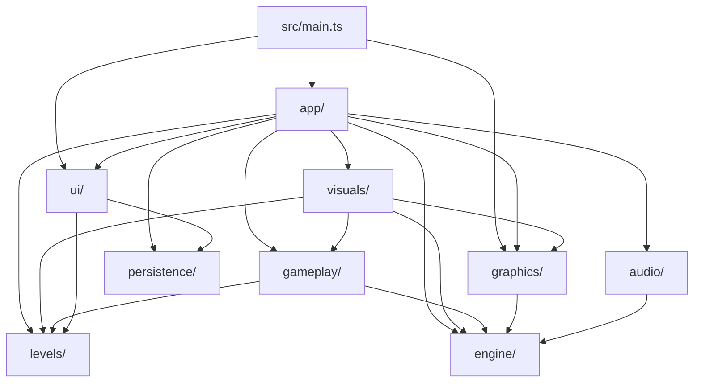

# PART 2 — Restructured Project Architecture (*STILLFRAME*)

This document explains how the monolithic [`legacy/Lab05-Testing-Index.html`](legacy/Lab05-Testing-Index.html) (~7 400 lines) was restructured into a maintainable npm + Vite + TypeScript codebase, how the modules are organized, why they were split this way, and how behaviour parity was verified.

> **Behaviour-preservation policy:** No game behaviour was intentionally altered during this refactor. Every bug noticed along the way (including the PLAY button not starting level 1-1 and the swapped `TimeScaleDriver.update` arguments) was logged in [BUGS.md](BUGS.md) and left untouched.

---

## 1. Project & Module Layout

```
lab5/
├── index.html                      # Thin Vite HTML entry (canvas + overlays + /src/main.ts)
├── package.json / package-lock.json
├── tsconfig.json                   # TypeScript config (ES2022, Bundler, @webgpu/types)
├── vite.config.ts                  # Vite + Vitest config (ports 5173/4173, sourcemaps)
├── eslint.config.js                # ESLint + enforced module dependency boundaries
├── .prettierrc.json / .editorconfig / .gitattributes / .nvmrc
├── .vscode/
│   ├── launch.json                 # F5: "Dev (Vite + Chrome)" & "Production (build + preview + Chrome)"
│   ├── tasks.json                  # dev-server, build, preview-server background tasks
│   ├── extensions.json             # Recommended WGSL, ESLint, Prettier, Vitest extensions
│   └── settings.json               # Workspace TS SDK, LF endings, format-on-save
├── README.md                       # Onboarding guide, scripts, F5 debug instructions
├── PART1.md                        # Original codebase analysis
├── PART2.md                        # This document
├── BUGS.md                         # Known bugs preserved untouched during the refactor
├── legacy/
│   └── Lab05-Testing-Index.html    # Original single-file game kept verbatim for reference
└── src/
    ├── main.ts                     # ~30-line entry point: boot() -> Gfx -> Game -> start()
    ├── vite-env.d.ts               # Vite client & ?raw asset types
    ├── styles/
    │   └── main.css                # Extracted stylesheet
    ├── app/                        # Top-level orchestration & game state machine
    │   └── game.ts                 # Game class, state transitions, per-frame glue
    ├── engine/                     # Game-agnostic runtime foundations
    │   ├── math.ts                 # Vector/scalar math helpers
    │   ├── rng.ts                  # Deterministic PRNG (Rng)
    │   ├── time.ts                 # Fixed-timestep accumulator & time-scale lock (Time)
    │   ├── loop.ts                 # requestAnimationFrame driver (Loop)
    │   ├── input.ts                # Keyboard, mouse pointer-lock, gamepad polling (Input)
    │   ├── camera.ts               # FPS perspective camera (Camera)
    │   └── time.test.ts
    ├── graphics/                   # WebGPU abstraction & multi-pass renderer
    │   ├── gfx.ts                  # Adapter/device init, resize/DPR, device-lost handling
    │   ├── mesh.ts                 # GPU vertex/index buffers & vertex layout
    │   ├── color.ts                # sRGB hex -> linear RGB conversion
    │   ├── mesh-builder.ts         # Procedural geometry builder
    │   ├── renderer.ts             # Instanced batching & 8-pass WebGPU pipeline
    │   └── shaders/
    │       ├── index.ts            # Composes shared chunks + stage files via ?raw imports
    │       ├── common.wgsl         # Shared uniforms & helpers
    │       ├── scene.wgsl          # Opaque lit geometry + PCF shadows
    │       ├── shadow.wgsl         # Directional shadow depth pass
    │       ├── glass.wgsl          # Refractive crystalline enemy shader
    │       ├── fx.wgsl             # Additive camera-facing beam/particle capsules
    │       ├── fullscreen.wgsl     # Fullscreen triangle vertex shader
    │       ├── outline.wgsl        # Depth/normal edge detection
    │       ├── bloom.wgsl          # Prefilter, downsample, upsample mip chain
    │       ├── final.wgsl          # Tonemap, freeze desaturation, aberration, vignette, grain
    │       └── shaders.test.ts
    ├── audio/                      # Procedural Web Audio
    │   ├── audio-engine.ts         # 3D panning, buses, time-scaled playbackRate
    │   └── synths.ts               # Procedural gunshot, impact, shatter, UI sound synths
    ├── levels/                     # Pure declarative level data
    │   ├── level-builder.ts        # LevelBuilder DSL, level(), LevelDef type
    │   ├── act1-transit.ts         # Act 1 (5 levels)
    │   ├── act2-office-tower.ts    # Act 2 (5 levels)
    │   ├── act3-rooftops.ts        # Act 3 (5 levels)
    │   ├── index.ts                # LEVELS, ACT_NAMES
    │   └── levels.test.ts
    ├── gameplay/                   # Headless simulation (zero DOM / WebGPU / Audio deps)
    │   ├── constants.ts            # Player dimensions, melee/throw/hearing constants
    │   ├── items.ts                # Weapon stats, item metadata, bullet constants
    │   ├── physics/
    │   │   ├── intersect.ts        # Ray/AABB, segment/sphere, segment/capsule primitives
    │   │   └── static-world.ts     # Spatial hash grid, raycast, character & sphere collision
    │   ├── navigation/
    │   │   └── nav-grid.ts         # 0.5 m walkability grid + A* pathfinding
    │   ├── enemies/
    │   │   ├── enemy.ts            # Enemy factory, archetype parameters, muzzle helper
    │   │   └── enemy-ai.ts         # Perception, state machine, shooting, melee
    │   ├── world.ts                # Authoritative simulation, waves, projectiles, events
    │   ├── player-controller.ts    # FPS movement, jump, gravity, enemy push-out
    │   ├── time-scale-driver.ts    # Core mechanic: movement/look/action -> time scale
    │   ├── replay.ts               # ReplayRecorder & deterministic ReplayPlayer
    │   ├── world.test.ts
    │   └── time-scale-driver.test.ts
    ├── visuals/                    # Game-specific presentation built on graphics/
    │   ├── visual-rng.ts           # Shared visualRng singleton (seed 12648430)
    │   ├── themes.ts               # Per-act material palettes & lighting presets
    │   ├── level-mesh.ts           # Builds static level mesh + shared collision/nav data
    │   ├── mesh-library.ts         # Procedural enemy body parts, weapons, props, shards
    │   ├── enemy-pose.ts           # Procedural skeletal pose matrices
    │   ├── fx-system.ts            # Particles & physical glass shards
    │   └── viewmodel.ts            # First-person hands & held weapon animation
    ├── ui/                         # DOM overlays, menus, HUD
    │   ├── ui.ts                   # Title, level select, settings, pause, results, replay UI
    │   ├── format.ts               # Time formatting (fmtTime)
    │   ├── debug-overlay.ts        # FPS / draw-call / entity counter HUD
    │   └── unsupported-panel.ts    # WebGPU fallback banner
    └── persistence/                # Browser storage
        ├── save.ts                 # Versioned localStorage save & settings defaults
        └── save.test.ts
```

---

## 2. Why It Was Split This Way

### 2.1 Responsibility-based boundaries for a team
Instead of dumping files into generic technical buckets (`classes/`, `helpers/`, `utils/`), every top-level folder owns a clear domain so multiple developers can work in parallel with minimal merge conflicts:

- **`engine/`** holds reusable, game-agnostic runtime primitives (`math`, `rng`, `time`, `loop`, `input`, `camera`). It knows nothing about enemies, weapons, or WebGPU pipelines.
- **`graphics/` vs `visuals/`** separates *how pixels get drawn* (WebGPU device, instanced batching, 8-pass pipeline, `.wgsl` shaders) from *what STILLFRAME looks like* (act colour themes, enemy limbs, weapon models, glass shards, viewmodel bob). A graphics engineer can optimize render passes without touching gameplay visuals, and an artist/developer can tweak enemy poses or themes without touching WebGPU bind groups.
- **`gameplay/` is completely headless.** It never imports `graphics/`, `visuals/`, `audio/`, `ui/`, or `app/`, and never touches `document` or `window`. That single boundary is what allows `World` and `TimeScaleDriver` to be unit-tested directly in Node (`vitest`) in milliseconds without a browser or GPU — and it is what makes deterministic replays possible.
- **`levels/` is pure data.** Grouping the 15 levels by act (`act1-transit.ts`, `act2-office-tower.ts`, `act3-rooftops.ts`) keeps each file short and lets level designers edit levels without touching simulation or rendering code.
- **`ui/` and `persistence/`** isolate DOM manipulation and `localStorage` serialization behind small interfaces, so save-file migration and formatting can be unit-tested independently.
- **`app/game.ts` and `main.ts`** keep all cross-subsystem wiring in one obvious place (`Game`), while `main.ts` stays a ~30-line bootstrapper.

### 2.2 Enforced dependency direction



These rules are enforced automatically by `no-restricted-imports` in [`eslint.config.js`](eslint.config.js), so accidental coupling (such as `gameplay/` importing `graphics/`) fails `npm run lint` immediately.

---

## 3. Shaders, Dependencies, and Developer Experience

- **Standalone `.wgsl` shaders:** The nine WGSL strings previously embedded inside template literals now live in `src/graphics/shaders/*.wgsl`. [`src/graphics/shaders/index.ts`](src/graphics/shaders/index.ts) imports them via Vite's `?raw` suffix and concatenates shared headers (`common.wgsl`, `fullscreen.wgsl`) in the exact order the legacy renderer used. Editors can now syntax-highlight and lint WGSL files, and [`src/graphics/shaders/shaders.test.ts`](src/graphics/shaders/shaders.test.ts) verifies every composed shader contains its expected entry points.
- **No CDN dependency:** The `https://cdn.jsdelivr.net/npm/wgpu-matrix@3.4.2/...` import was replaced with `"wgpu-matrix": "^3.4.2"` in [`package.json`](package.json), so the project builds and runs fully offline and under Vitest.
- **Comfortable F5 debugging (Dev & Production):**
  - [`vite.config.ts`](vite.config.ts) fixes ports (`5173` dev, `4173` preview) and enables `build.sourcemap: true`.
  - [`.vscode/tasks.json`](.vscode/tasks.json) defines `dev-server`, `build`, and `preview-server` (which depends on `build`), with background problem matchers that detect Vite's ready output.
  - [`.vscode/launch.json`](.vscode/launch.json) provides **Dev (Vite + Chrome)** and **Production (build + preview + Chrome)**, both with `"sourceMaps": true`, `"webRoot": "${workspaceFolder}"`, WebGPU flags, and automatic server shutdown on debug stop — so breakpoints placed in `.ts` files bind and pause in both dev and production modes.

---

## 4. How Behaviour Parity Was Preserved

1. **Strangler-fig extraction:** Rather than rewriting into empty files and hoping it worked at the end, we first got the entire original script running as a monolithic Vite + TypeScript app with npm `wgpu-matrix` (baseline commit). Each subsequent commit peeled one responsibility out of `src/main.ts`, imported it back, and ran `npm test && npm run build`.
2. **Characterization tests (29 tests across 6 suites):**
   - `src/engine/time.test.ts` — fixed step `1/120`, `realDt` clamp, accumulator cap, freeze lock.
   - `src/graphics/shaders/shaders.test.ts` — all 7 composed shader programs and entry points.
   - `src/levels/levels.test.ts` — 15 levels, 5 per act, ordering, geometry & spawn presence.
   - `src/gameplay/world.test.ts` — headless construction of all 15 levels and 1-second simulation tick.
   - `src/gameplay/time-scale-driver.test.ts` — `TimeScaleDriver` math (min floor, walk speed, airborne floor, action kick).
   - `src/persistence/save.test.ts` — defaults, version mismatch, partial merge, corrupt JSON recovery, `fmtTime`.
3. **Zero unintended edits:** Known bugs were intentionally preserved and documented in [BUGS.md](BUGS.md) for the next lab phase.
